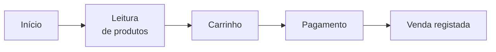
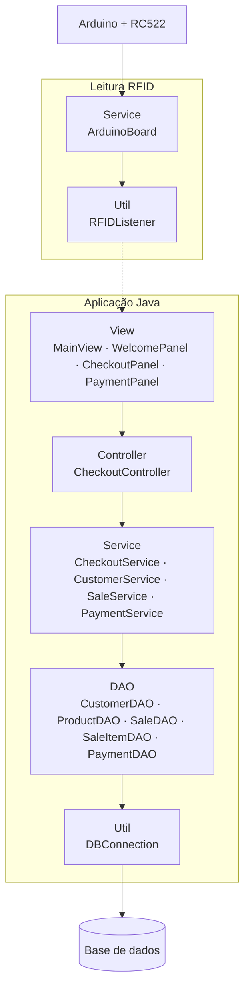
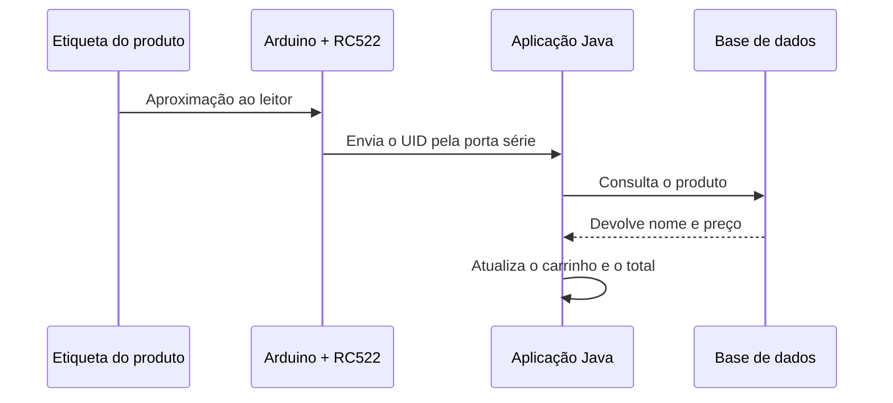

<h1 align="center">Self-Checkout RFID</h1>

<p align="center">
  Protótipo de caixa de autoatendimento em Java, com leitura de produtos por RFID.
</p>

<p align="center">
  
  
  
  
  
  
</p>

<p align="center">
  
  
  
  
</p>
---

## Índice

- [Sobre](#sobre)
- [Fluxo](#fluxo)
- [Tecnologias](#tecnologias)
- [Arquitetura](#arquitetura)
- [Estrutura do projeto](#estrutura-do-projeto)
- [Comunicação com Arduino e RFID](#comunicação-com-arduino-e-rfid)
- [Como executar](#como-executar)
- [Estado do protótipo](#estado-do-protótipo)

---

## Sobre

O Self-Checkout RFID é um protótipo de caixa de autoatendimento que permite ao cliente fazer a sua compra de forma autónoma, sem operador de caixa.

Na interface gráfica, o cliente inicia a compra e passa os produtos pelo leitor. Cada etiqueta RFID é reconhecida e consultada na base de dados, e o carrinho mostra em tempo real os produtos, as quantidades e o total. No fim, o cliente escolhe o método de pagamento e conclui a compra.

A leitura das etiquetas é feita por um Arduino com módulo RC522, que envia os identificadores à aplicação Java.

---

## Fluxo



**1. Início**
O cliente começa a compra no ecrã inicial.

**2. Leitura de produtos**
Aproxima cada produto do leitor RFID. O sistema identifica a etiqueta e consulta as informações do produto na base de dados.

**3. Carrinho**
Os produtos são adicionados ao carrinho, com nome, preço, quantidade e total da compra.

**4. Pagamento**
O cliente avança para o pagamento e seleciona o método disponível.

**5. Finalização**
O sistema regista a venda, os respetivos itens e as informações do pagamento na base de dados.

---

## Tecnologias

| Tecnologia | Utilização |
|---|---|
| **Java** | Aplicação principal e interface gráfica, organizada nos painéis `WelcomePanel`, `CheckoutPanel` e `PaymentPanel` |
| **Maven** | Gestão do projeto e das dependências |
| **JDBC** | Comunicação com a base de dados: produtos, vendas, itens e pagamentos |
| **Arduino (C++)** | Leitura dos identificadores RFID e envio para a aplicação |
| **RFID RC522** | Leitor das etiquetas RFID dos produtos |

---

## Arquitetura

O backend segue uma arquitetura em camadas.



O acesso à base de dados passa sempre pelos DAO, que usam o `DBConnection`. A leitura RFID segue um caminho próprio: o Arduino envia o UID para o `ArduinoBoard`, o `RFIDListener` recebe-o e entrega-o à interface, sem passar pelo `CheckoutController` nem pelos DAO.

| Camada | Função |
|---|---|
| `Controller` | Recebe e coordena as ações da interface (`CheckoutController`) |
| `Service` | Lógica de negócio: checkout, clientes, vendas e pagamentos. Inclui o `ArduinoBoard`, que faz a ligação à placa Arduino |
| `DAO` | Acesso à base de dados, através do `DBConnection` |
| `Model` | Entidades: `Customer`, `Product`, `Cart`, `Sale`, `SaleItem` e `Payment` |
| `Util` | `DBConnection`, que gere a ligação à base de dados, e `RFIDListener`, que recebe as leituras RFID |
| `View` | Interface gráfica, dividida em painéis |

---

## Estrutura do projeto

```text
.
├── pom.xml
├── README.md
└── src
    └── main
        ├── java
        │   ├── com/selfcheckout
        │   │   ├── arduino
        │   │   │   └── RFIDReader.cpp       # Código do Arduino (RC522)
        │   │   ├── controller
        │   │   │   └── CheckoutController.java
        │   │   ├── dao
        │   │   │   ├── CustomerDAO.java
        │   │   │   ├── PaymentDAO.java
        │   │   │   ├── ProductDAO.java
        │   │   │   ├── SaleDAO.java
        │   │   │   └── SaleItemDAO.java
        │   │   ├── model
        │   │   │   ├── Cart.java
        │   │   │   ├── Customer.java
        │   │   │   ├── Payment.java
        │   │   │   ├── Product.java
        │   │   │   ├── Sale.java
        │   │   │   └── SaleItem.java
        │   │   ├── service
        │   │   │   ├── ArduinoBoard.java
        │   │   │   ├── CheckoutService.java
        │   │   │   ├── CustomerService.java
        │   │   │   ├── PaymentService.java
        │   │   │   └── SaleService.java
        │   │   ├── util
        │   │   │   ├── DBConnection.java
        │   │   │   └── RFIDListener.java
        │   │   └── view
        │   │       ├── MainView.java
        │   │       ├── checkout/CheckoutPanel.java
        │   │       ├── payment/PaymentPanel.java
        │   │       └── welcome/WelcomePanel.java
        │   └── org/example
        │       └── Main.java                # Ponto de entrada
        └── resources
            └── icons                        # Ícones da interface (SVG/PNG)
```

---

## Comunicação com Arduino e RFID

O Arduino com leitor RC522 lê as etiquetas dos produtos e envia o identificador (UID) de cada leitura para a aplicação Java, através da porta série. Do lado Java, o `RFIDListener` recebe esses identificadores e a aplicação consulta o produto correspondente para o adicionar ao carrinho.



### Ligações do RC522

Valores de referência para o Arduino Uno. Confirma-os de acordo com a tua montagem.

| RC522 | Arduino Uno |
|:---:|:---:|
| SDA (SS) | 10 |
| SCK | 13 |
| MOSI | 11 |
| MISO | 12 |
| RST | 9 |
| GND | GND |
| 3.3V | 3.3V |

O módulo RC522 funciona a 3.3 V. Ligá-lo a 5 V pode danificá-lo.

---

## Como executar

### Requisitos

- JDK [17 ou superior]
- Maven 3.8 ou superior
- Servidor de base de dados [MySQL / PostgreSQL / ...]
- Arduino IDE
- Arduino com módulo RFID RC522 e cabo USB
- Etiquetas RFID compatíveis com o RC522

### 1. Obter o projeto

```bash
git clone https://github.com/jrdimande/self-checkout.git
cd self-checkout
```

### 2. Configurar a base de dados

Cria a base de dados e as tabelas correspondentes às entidades do sistema: produtos, vendas, itens de venda e pagamentos.

```sql
CREATE DATABASE self_checkout;
```

Em seguida, regista alguns produtos de teste, cada um com o UID da etiqueta RFID, o nome e o preço.

Depois, ajusta os dados de ligação na classe `DBConnection`:

```java
// com/selfcheckout/util/DBConnection.java
String url      = "jdbc:[mysql]://localhost:[3306]/[nome_da_bd]";
String user     = "[utilizador]";
String password = "[palavra-passe]";
```

### 3. Carregar o código no Arduino

1. Liga o módulo RC522 ao Arduino, conforme a tabela de ligações acima.
2. Abre o Arduino IDE e cria um novo sketch.
3. Copia para lá o conteúdo de `RFIDReader.cpp`.
4. Instala a biblioteca **MFRC522** em *Ferramentas > Gerir bibliotecas*.
5. Seleciona a placa e a porta e faz o upload.
6. Anota a porta série utilizada (por exemplo `COM3` no Windows ou `/dev/ttyUSB0` no Linux).

### 4. Configurar a porta série

Indica a porta anotada no passo anterior na classe responsável pela comunicação com o Arduino (`ArduinoBoard` / `RFIDListener`), e confirma que o baud rate é o mesmo definido no código do Arduino.

### 5. Compilar e executar

```bash
mvn clean install
```

A classe principal é `org.example.Main`. Podes executá-la diretamente a partir do IDE (IntelliJ IDEA, Eclipse ou NetBeans) ou pela linha de comandos:

```bash
mvn exec:java -Dexec.mainClass="org.example.Main"
```

### Problemas comuns

| Problema | Possível causa |
|---|---|
| A aplicação não liga à base de dados | Credenciais incorretas em `DBConnection` ou servidor desligado |
| Nenhuma leitura RFID chega à aplicação | Porta série errada, baud rate diferente ou porta ocupada pelo Serial Monitor do Arduino IDE |
| Produto não reconhecido | O UID da etiqueta não está registado na tabela de produtos |

---

## Estado do protótipo

Este projeto é um protótipo desenvolvido para demonstrar o conceito de self-checkout com RFID. Funcionalidades como a integração real com serviços de pagamento, a emissão de talão e a gestão de stock não estão incluídas.

---

## Autor

Timóteo Dimande Júnior  
GitHub: [jrdimande](https://github.com/jrdimande)